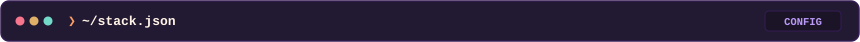
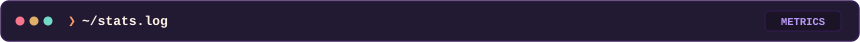
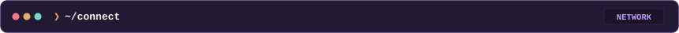

<!-- markdownlint-disable -->
<div align="center">

  <!-- Glitch & Scanline Terminal Banner (Custom Animated SVG) -->
  <a href="https://github.com/404-Lux">
    
  </a>

  <br />

  <!-- Animated Monospace Subtitle (No Emojis) -->
  <p align="center">
    <a href="https://git.io/typing-svg">
      
    </a>
  </p>

  <!-- Status & Fuel Badges -->
  <p align="center">
    <a href="https://github.com/404-Lux">
      
    </a>
    <a href="https://github.com/404-Lux">
      
    </a>
    <a href="https://github.com/404-Lux">
      
    </a>
    
  </p>

</div>

<p align="center">
  
</p>

<!-- SECTION 1: ABOUT -->
<p align="center">
  
</p>

```text
┌──(lux㉿cozy-box)-[~]
└─$ whoami
LUX (404-Lux) ▸ Frontend & Web Developer ▸ Focus: React, Next.js & TypeScript

┌──(lux㉿cozy-box)-[~]
└─$ cat about.txt
Hey there. I'm LUX. I build modern, high-performance web interfaces
using HTML, CSS, JavaScript, TypeScript, React, and Next.js.
When headphones are on, I'm turning ideas into clean code, solving UI
challenges, and listening to lo-fi beats with ice-cold Coca-Cola at hand.
```

▸ **audio_stream:** Lo-Fi beats 24/7  
▸ **daily_fuel:** Cold Coca-Cola & curiosity  
▸ **core_stack:** React, Next.js, TypeScript, JavaScript, HTML5, CSS3  
▸ **mascot_vibe:** Orange tabby cat wearing headphones at workstation  
▸ **contact_query:** React/Next.js builds, frontend architecture, or lo-fi playlists  

<br />

<!-- NOW PLAYING TERMINAL WIDGET -->
```text
┌──(lux㉿cozy-box)-[~]
└─$ player --now-playing
[⏵] Lo-Fi Coding Session #404 (Chill Cat Beats)
    ████████████████░░░░░░░░░░░░ 02:40 / 04:04
    Track: Midnight Cola & Chill Chords  |  Status: Looping
```

<p align="center">
  
</p>

<!-- SECTION 2: TECH STACK -->
<p align="center">
  
</p>

<p align="center">
  
</p>

<details>
<summary><b>▸ [CLICK TO EXPAND] View Categorized Tech Arsenal</b></summary>
<br />

```json
{
  "developer": "LUX",
  "handle": "404-Lux",
  "technologies": {
    "languages": ["HTML5", "CSS3", "JavaScript (ES6+)", "TypeScript"],
    "frameworks_and_styling": ["React.js", "Next.js", "Tailwind CSS"],
    "tooling_and_workflow": ["Git", "GitHub", "VS Code", "Terminal (Bash/Zsh)"]
  },
  "environment": "Lo-Fi Focus, Midnight Coffee & Coca-Cola"
}
```

</details>

<p align="center">
  
</p>

<!-- SECTION 3: PROJECTS -->
<p align="center">
  
</p>

<details open>
<summary><b>▸ OJT-Time-Tracker</b> <code>[HTML / CSS / JavaScript]</code></summary>
<br />

> **Repository:** [github.com/404-Lux/OJT-Time-Tracker](https://github.com/404-Lux/OJT-Time-Tracker)  
> **Description:** A streamlined, intuitive time and attendance tracking web application built to log on-the-job training hours and progress with clean local state handling.  
> **Stack:** `HTML5` `CSS3` `JavaScript`

</details>

<br />

<details>
<summary><b>▸ Lauryn-and-Littles</b> <code>[HTML / Responsive Showcase]</code></summary>
<br />

> **Repository:** [github.com/404-Lux/Lauryn-and-Littles](https://github.com/404-Lux/Lauryn-and-Littles)  
> **Description:** A responsive, aesthetic web showcase project designed with semantic HTML markup, custom layout styling, and delightful micro-interactions.  
> **Stack:** `HTML5` `CSS3` `Responsive UI`

</details>

<br />

<details>
<summary><b>▸ tapkonek-harra</b> <code>[Web Application]</code></summary>
<br />

> **Repository:** [github.com/404-Lux/tapkonek-harra](https://github.com/404-Lux/tapkonek-harra)  
> **Description:** [EDIT ME: Add 1-sentence description of tapkonek-harra project features and purpose].  
> **Stack:** `JavaScript` `HTML5` `CSS3`

</details>

<br />

<details>
<summary><b>▸ ls -a all_repositories</b> <code>[GitHub Catalog]</code></summary>
<br />

> **Repository Index:** [github.com/404-Lux?tab=repositories](https://github.com/404-Lux?tab=repositories)  
> **Description:** Browse all open-source repositories, components, and ongoing experiments under the 404-Lux workspace.  
> **Command:** `$ gh repo list 404-Lux --public`

</details>

<p align="center">
  
</p>

<!-- SECTION 4: STATS & ACTIVITY -->
<p align="center">
  
</p>

<div align="center">

  <!-- GitHub Stats Card -->
  
  &nbsp;
  <!-- GitHub Streak Card (Reliable Demolab Endpoint) -->
  

  <br /><br />

  <!-- Top Languages Card -->
  

  <br /><br />

  <!-- Contribution Grid Snake Animation (Workflow Output) -->
  

</div>

<p align="center">
  
</p>

<!-- SECTION 5: CONNECT -->
<p align="center">
  
</p>

<p align="center">
  <a href="mailto:lux@example.com">
    
  </a>
  &nbsp;
  <a href="https://github.com/404-Lux">
    
  </a>
  &nbsp;
  <a href="https://linkedin.com/in/404-lux">
    
  </a>
</p>

<br />

<!-- EASTER EGG: CAT TERMINAL -->
```text
       |\__/,|   (`\
     _.|o o  |_   ) )     [ PURRING IN TYPESCRIPT ]
   -(((---(((--------     "404: Sleep not found. Code running smoothly."
```

<p align="center">
  
</p>

<div align="center">
  <sub>Crafted in <b>JetBrains Mono</b> ▸ Palette: <code>#1a1426</code> • <code>#bb9af7</code> • <code>#ff9e64</code> ▸ <i>"Page not found? Try again with more cola."</i></sub>
</div>
