<!-- markdownlint-disable -->

  <!-- Glitch & Scanline Terminal Banner (Custom Animated SVG) -->
  

   

  <!-- Animated Monospace Subtitle (No Emojis) -->
  

    
  

  <!-- Status & Fuel Badges -->
  

    
    
    
    
  

  

<!-- =========================================================================
     SECTION 1: ABOUT
     ========================================================================= -->

  

<!-- Unified Terminal Window + Cat Mascot Card (100% Full-Width) -->

  

 

<!-- 4 Key Info Metric Cards -->

  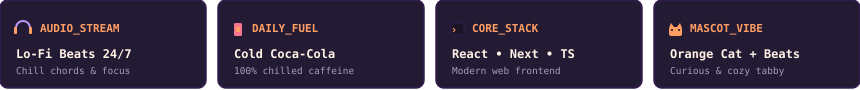

  

<!-- =========================================================================
     SECTION 2: NOW PLAYING LO-FI MUSIC BAR
     ========================================================================= -->

  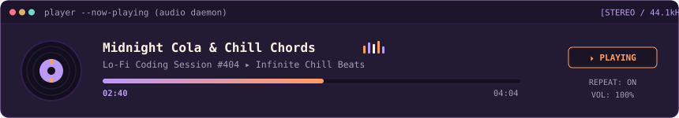

  

<!-- =========================================================================
     SECTION 3: TECH ARSENAL & SKILLS
     ========================================================================= -->

  

<!-- Skill Icons -->

  

 

<!-- 3-Column Mini Terminal Cards with Animated Level Bars -->

  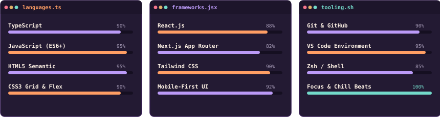

  

<!-- =========================================================================
     SECTION 4: FEATURED BUILDS & REPOSITORIES
     ========================================================================= -->

  

<!-- 2-Column Responsive Project Grid (No Table Borders, Edge-to-Edge) -->

  

    <a href="https://github.com/404-Lux/OJT-Time-Tracker">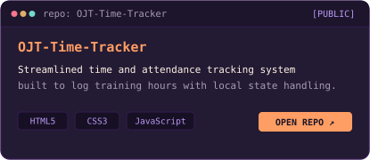</a>
    <a href="https://github.com/404-Lux/Lauryn-and-Littles">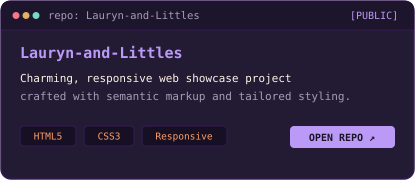</a>
    <a href="https://github.com/404-Lux/tapkonek-harra">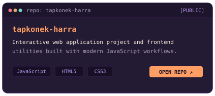</a>
    <a href="https://github.com/404-Lux?tab=repositories">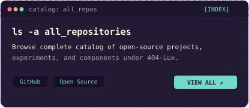</a>
  

  
<code>▸ text-only links</code>

   

* **[OJT-Time-Tracker](https://github.com/404-Lux/OJT-Time-Tracker)** — Streamlined time and attendance tracking web application built to log training hours with local state handling (`HTML5`, `CSS3`, `JavaScript`).
* **[Lauryn-and-Littles](https://github.com/404-Lux/Lauryn-and-Littles)** — Responsive web showcase project crafted with semantic markup and tailored styling (`HTML5`, `CSS3`, `Responsive UI`).
* **[tapkonek-harra](https://github.com/404-Lux/tapkonek-harra)** — Interactive web application project and frontend utilities architecture (`JavaScript`, `HTML5`, `CSS3`).
* **[All Repositories](https://github.com/404-Lux?tab=repositories)** — Complete open-source index under the 404-Lux catalog.

  

<!-- =========================================================================
     SECTION 5: STATS & CONTRIBUTION METRICS
     ========================================================================= -->

  

  <!-- GitHub Stats Card -->
  
  &nbsp;
  <!-- GitHub Streak Card (Fixed Readable Numbers in Dark & Light Modes) -->
  

    

  <!-- Top Languages Card -->
  

 

<!-- Snake Contribution Titlebar & Animation -->

  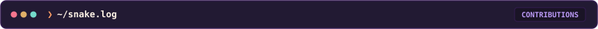

  <picture>
    <source media="(prefers-color-scheme: dark)" srcset="https://raw.githubusercontent.com/404-Lux/404-Lux/output/github-contribution-grid-snake-dark.svg">
    <source media="(prefers-color-scheme: light)" srcset="https://raw.githubusercontent.com/404-Lux/404-Lux/output/github-contribution-grid-snake.svg">
    
  </picture>

  

<!-- =========================================================================
     SECTION 6: CONNECT & NETWORK
     ========================================================================= -->

  

  <a href="mailto:harra.ramos26@gmail.com">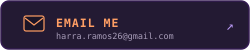</a>&nbsp;&nbsp;<a href="https://www.instagram.com/harramos_26/">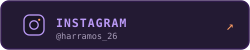</a>&nbsp;&nbsp;<a href="http://tiktok.com/@codebyher">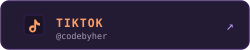</a>

 

<!-- EASTER EGG: COZY CAT TERMINAL SCENE -->

  

  

  Palette: <code>#1a1426</code> • <code>#bb9af7</code> • <code>#ff9e64</code> ▸ Designed with pure SVGs &amp; code ▸ <i>"Page not found? Try again with more cola."</i>

 
    

    
